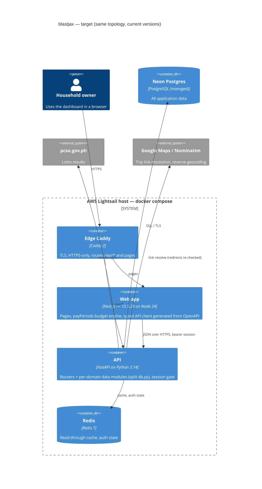
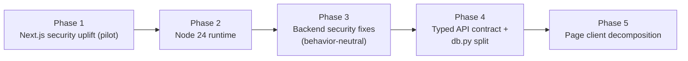

# Modernization Brief — blastjax

Date: 2026-11-09 · Status: **awaiting approval** · Target stack: same stack, current versions (Python 3.14 / FastAPI,
Next.js ≥ 15.5.29 on Node 24 LTS) — recommended from the assessment, because `INTENT.md` (goal: understand) names no target.

Inputs (all 2026-11-09): `INTENT.md` 10:04 · `PREFLIGHT.md` 10:06 · `ASSESSMENT.md` 10:53 · `DELTA_CATALOG.md` 11:55 ·
`SECURITY_FINDINGS.md` 11:59 · `BUSINESS_RULES.md` 14:52 · `DATA_OBJECTS.md` 14:54 · `topology.json` 15:17 ·
`RULE_REVIEWS.md` 17:24. Regenerate this brief if any of them changes.

**How to steer it:** edit this file. Entry and exit criteria below are binding on the build commands; they may tick a
box or add a note, never reword a criterion. A chat message does not change the plan; an edited criterion does.

## 1. Objective

blastjax is a working personal finance-and-lifestyle dashboard (FastAPI + Next.js over Neon Postgres, ~37.8 KSLOC) on a
current stack. It does not need a rewrite. It needs four things, in this order: the security fixes that are safe to make
(a critical Next.js advisory, an end-of-life Node runtime, and the Medium findings that do not change confirmed
behavior); then structural refactoring of the three oversized units (`backend/db.py`, `web/src/lib/api.ts`, the largest
page clients) behind a typed API contract, so future changes stop touching everything. Why now: the Next.js advisory is
critical and public, and Node 20 is already past end of life. The owner's constraints (`INTENT.md`) hold throughout:
the app keeps running, behavior matches exactly (all 37 reviewed rules were confirmed as wanted, see §5), known bugs are
fixed only where a confirmed rule does not say otherwise, and the security review came first (it did, `SECURITY_FINDINGS.md`).

## 2. Target Architecture

Same containers as today; versions move and the internals of three units are reorganized.



| Legacy component | Target component |
|---|---|
| `web/package.json` Next 15.5.14, `Dockerfile.web` / CI on Node 20 | Next ≥ 15.5.29, Node 24 LTS (Phases 1–2) |
| `backend/db.py` (one 2,056-line module) | One data module per domain behind the same function names (Phase 4) |
| `web/src/lib/api.ts` (hand-written types) + untyped FastAPI responses | FastAPI `response_model`s + TypeScript types generated from OpenAPI (Phase 4) |
| `web/src/app/{calendar,lotto,travels,installments,credit-card}/*Client.tsx` | Same pages, data hooks and subcomponents extracted (Phase 5) |
| `routers/travel.py` link resolver, `routers/auth.py` throttle, `services/bill_extract.py`, `docker/Caddyfile` | Same files with the Medium security fixes (Phase 3) |
| Everything else (routers, services, schema sync, cache, payPeriods engine, deploy) | Unchanged |

## 3. Phased Sequence

Ordered build-graph leaf-first for a same-stack uplift: the dependency and runtime moves first (they bite every web
module), then the backend fixes, then the refactors that need a typed contract in place. **Phase 1 is a pilot and this
brief is a hypothesis:** what Phase 1 surfaces (a delta the catalog missed, a lockfile surprise, a deploy-time fact
nobody wrote down) is expected to revise this brief, and regenerating it after the pilot is the normal path.

Override checks (uplift rules): the test harness runs unchanged on the target (`DELTA_CATALOG.md`: `tsc`, ESLint,
`next build` and `backend/test_core.py` all pass), so no harness-first phase is needed. No dependency delta is shared
across a coordinated cut. No shared node has consumers outside the scope (`PREFLIGHT.md` Check 6: standalone repository).



#### Phase 1 — Next.js security uplift (pilot)
Command: /code-modernization:modernize-uplift
Modules: web:layout, web:lib:api
Scale: S
Risk: Low; (1) lockfile drift breaks `npm ci` in CI and Docker — mitigated by committing the regenerated lockfile (already in `security_remediation.patch`); (2) a transitive bump changes build output — mitigated by `next build` plus a manual smoke of the four persona flows.
Entry criteria:
- [x] `analysis/blastjax/security_remediation.patch` reviewed, with a decision recorded on its SEC-002/SEC-003 hunks (§7, first question) — Note: owner chose the whole patch, 2026-11-09.
- [ ] `web/` builds today on the current lockfile (`npm ci && npx tsc --noEmit && npm run lint && npx next build`)
Exit criteria:
- [ ] `web/package-lock.json` resolves `next` and `eslint-config-next` to 15.5.29 or later
- [ ] `npm audit` reports 0 critical advisories in `web/`
- [ ] `npx tsc --noEmit`, `npm run lint` and `npx next build` pass in CI
- [ ] The deploy job finishes green and the four persona flows (§4) work on the deployed site

#### Phase 2 — Node 24 runtime
Command: /code-modernization:modernize-uplift
Modules: web:layout
Scale: S
Risk: Low; (1) sharp/libvips on bookworm with Node 24 untested here — mitigated by building the image locally before pushing; (2) healthcheck behavior on a new Node — mitigated by `docker compose ps web` reporting healthy before merge.
Entry criteria:
- [ ] Phase 1 exit criteria all ticked
- [ ] `npm audit fix` (never `--force`) applied and the remaining advisories accepted or overridden per `DELTA_CATALOG.md` #6
Exit criteria:
- [ ] `docker/Dockerfile.web` stages 1 and 2 and `.github/workflows/deploy.yml` use Node 24
- [ ] `docker build -f docker/Dockerfile.web web` succeeds and `docker compose ps web` reports healthy
- [ ] One full CI run on Node 24 is green and the deployed site serves the four persona flows

#### Phase 3 — Backend security fixes (behavior-neutral)
Command: /code-modernization:modernize-uplift
Modules: be:router:travel, be:router:auth, be:service:bill_extract, be:core:deps
Scale: M
Risk: Medium; (1) a fix changes behavior an owner confirmed (RULE-002 to RULE-009 are all confirmed as wanted) — mitigated by limiting this phase to findings no confirmed rule covers (SEC-004 SSRF redirects, SEC-007 image resize bomb, SEC-008 plain-HTTP IP site, SEC-014 upload bytes, SEC-019 log redaction) and listing any other as an open question; (2) the forwarded-IP change (SEC-005) depends on the edge network — mitigated by testing the lockout from two clients before deploy.
Entry criteria:
- [ ] Phase 2 exit criteria all ticked
- [ ] Each fix in scope is checked against `RULE_REVIEWS.md`: none contradicts a confirmed rule, or the owner has re-reviewed that rule
- [ ] `backend/test_core.py` passes against a throwaway Postgres before the first change
Exit criteria:
- [ ] Each fixed finding has a `check_*` in `backend/test_core.py` that fails on the old code and passes on the new
- [ ] `/code-modernization:modernize-harden blastjax` re-run shows the fixed findings as resolved
- [ ] All P0 rules in §5 still hold (characterization checks pass unchanged)

#### Phase 4 — Typed API contract and db.py split
Command: /code-modernization:modernize-uplift
Modules: be:core:db, be:schemas, web:lib:api, be:router:credit_card, be:router:installment, be:router:payslip
Scale: L
Risk: Medium; (1) splitting `db.py` breaks a cross-domain write (card payment → fixed expense, RULE-045 to RULE-047) — mitigated by characterization checks on those rules first and keeping every public function name; (2) generated types differ from hand-written ones and break pages — mitigated by generating into a new file and switching one page at a time, `tsc` gating each step.
Entry criteria:
- [ ] Phase 3 exit criteria all ticked
- [ ] Characterization checks exist for every P0 rule in §5 whose source is in `backend/` (run against a throwaway Postgres)
- [ ] Pilot slice chosen: the credit-card domain (`be:router:credit_card` and its `db.py` functions) goes first
Exit criteria:
- [ ] Every router declares a `response_model`; `web/src/lib/api.ts` types are generated from `/openapi.json` and `tsc` passes
- [ ] `backend/db.py` is split into per-domain modules with no function signature changed; all callers import unchanged names
- [ ] All P0 rule characterization checks pass unchanged

#### Phase 5 — Page client decomposition
Command: /code-modernization:modernize-uplift
Modules: web:calendar, web:lotto, web:travels, web:installments, web:credit-card
Scale: L
Risk: Medium; (1) the budget engine's browser-side rules (RULE-026 to RULE-035, RULE-049, RULE-051) move with the code — mitigated by unit checks for `web/src/lib/payPeriods.ts` before touching the calendar; (2) UI drift — mitigated by keeping the shared components (FinanceUI kit, pickers, YearMonthGrid) as the only building blocks.
Entry criteria:
- [ ] Phase 4 exit criteria all ticked
- [ ] Runnable checks exist for RULE-026, RULE-027, RULE-030, RULE-031, RULE-032 (`payPeriods.ts`) and run in CI
- [ ] Pilot slice: `web/src/app/calendar` first
Exit criteria:
- [ ] No page client component exceeds 600 lines; data loading lives in hooks
- [ ] The `payPeriods` checks and `tsc`/lint pass in CI; the four persona flows behave as before

## 4. Business Walkthroughs

From the map's persona flows (`topology.json`). Every step keeps its behavior; only the phase that touches its code changes.

**Record a credit-card payment** (you, running the household budget) — you mark a card statement paid and the payment lands on the budget calendar.

| Step | Legacy modules | Phase |
|---|---|---|
| Open Credit Cards and record the payment | `web:credit-card`, `web:lib:api` | 4 (types), 5 (page) |
| The API saves the payment | `be:router:credit_card`, `be:core:db` | 4 |
| The payment also becomes a fixed expense on its day | `ds:fixed_expense` | 4 (RULE-045 kept) |
| The page re-spreads the pay-period budget | `web:lib:payPeriods`, `be:router:calendar_day_override` | 5 (RULE-030 kept) |
| The calendar shows the new daily amounts | `ds:calendar_day_override`, `web:calendar` | 5 |

**Add a bill from a photo** (you, paying the monthly bills) — upload a photo or PDF and the amount and due date are read for you.

| Step | Legacy modules | Phase |
|---|---|---|
| Upload the bill | `web:bills`, `web:lib:api` | 4 |
| The API checks the file | `be:router:bill`, `be:core:deps` | 3 (SEC-014) |
| Text is read from the PDF or photo | `be:service:bill_extract` | 3 (SEC-007) |
| The bill is saved; linked views refresh | `be:core:db`, `ds:bill`, `be:core:factory`, `ds:redis` | 4 |

**Import a payslip** (you, tracking salary) — a payslip PDF feeds salary stats and the budget.

| Step | Legacy modules | Phase |
|---|---|---|
| Upload and parse the payslip | `web:payslip`, `be:router:payslip`, `be:service:payslip_parse` | 4 |
| Stored with its company | `be:core:db`, `ds:payslip` | 4 (RULE-014 kept) |
| Salary stats and the calendar read it | `web:salary-stats`, `web:calendar` | 5 |

**Log in** (anyone, once users exist) — password or passkey, then every page opens behind the session gate.

| Step | Legacy modules | Phase |
|---|---|---|
| The app checks whether a login is needed | `web:components:AuthGate`, `be:router:auth` | 3 (only if §7 decides) |
| Password or passkey is verified | `be:core:security`, `be:core:passwords` | 3 (SEC-005 if decided) |
| Session issued, every call checked | `ds:app_user_session`, `ds:redis`, `be:core:deps`, `be:core:factory` | unchanged |

## 5. Behavior Contract

The 50 P0 rules in `BUSINESS_RULES.md` must be proven equivalent before any phase that touches their source ships; they
become the regression suite. **37 of them were reviewed by the owner and all 37 confirmed** (`RULE_REVIEWS.md`); the other
13 are High-confidence with no defect or open question. There are **no blockers**: no P0 rule is below High confidence
without a person's confirmation.

Confirmed means "the code does this today and it is wanted as it is", including the suspected defects noted on those
cards. A phase that wants to change one of them (for example the last-user guard against RULE-005) is a deliberate
deviation: it must re-run `/code-modernization:modernize-review blastjax` for that rule first.

| Area | P0 rules | Covered by |
|---|---|---|
| Login, sessions, user admin | RULE-001 to RULE-009, RULE-012 | `backend/test_core.py` (sessions, passkeys) + new characterization checks (Phase 3/4) |
| Deletes and links | RULE-010, RULE-011, RULE-014 | DB checks against a throwaway Postgres (Phase 4) |
| Input limits | RULE-013, RULE-016 to RULE-024 | API-level checks on the Pydantic schemas and routers (Phase 4) |
| Budget engine (browser) | RULE-026 to RULE-035 | `payPeriods` unit checks (Phase 5 entry) |
| Installments and cards | RULE-036 to RULE-040, RULE-045 to RULE-052 | `backend/test_core.py` (statement, card balance) + characterization (Phase 4) |
| Platform lifecycle | RULE-053 to RULE-056 | Deploy run + startup checks (every phase) |

## 6. Validation Strategy

| Phase | Characterization | Contract | Dual-execution diff | Property-based | Manual UAT |
|---|---|---|---|---|---|
| 1 Next.js uplift | — | `tsc`, lint, `next build` | — | — | Four persona flows on the deployed site |
| 2 Node 24 | — | Docker build + healthcheck | — | — | Four persona flows |
| 3 Security fixes | New `check_*` per fix in `test_core.py` | — | — | Upload bytes and image sizes (SEC-007, SEC-014) | Lockout from two clients |
| 4 Contract + db split | P0 backend rules against a throwaway Postgres | OpenAPI-generated types + `tsc` | Old vs new `db.py` functions on the same seeded data | Installment aggregates (RULE-036), even split (RULE-032) | Card payment flow |
| 5 Page decomposition | `payPeriods` checks (RULE-026–035) | `tsc` | — | Pay-period boundaries over a year of dates | Calendar and card flows |

## 7. Open Questions

- [x] **Security patch vs confirmed rules.** Decided 2026-11-09: "Whole patch". RULE-003 and RULE-005 are now deliberate changes; their new behavior is the patch hunks plus `check_settings_access`. `security_remediation.patch` hunks SEC-002 (user admin needs Settings access) and SEC-003 (refuse deleting the last user) change behavior that RULE-003 and RULE-005 confirm as wanted. Apply them anyway (a deliberate deviation, then re-review those rules), or apply only the SEC-001 Next.js hunks?
- [ ] **Credentials.** Rotate the production Neon owner credentials in the local `.env` files and point local work at a Neon dev branch (`SECRETS.local.md`), before Phase 1 touches anything that runs locally.
- [ ] **Python dependency audit.** `pip-audit` was not run (`SECURITY_FINDINGS.md`, coverage gaps). Install it and re-run harden before Phase 3?
- [ ] **postcss override.** Accept Next 15.5's pinned `postcss@8.4.31` (build-time only) or add the override from `DELTA_CATALOG.md` #6?
- [ ] **Node 22 or 24.** This brief targets 24 (22 is end of life on 2027-04-30). Confirm.
- [ ] **Commit the analysis.** `analysis/` (minus the gitignored secrets file) and the new `.archify/` diagram folder are untracked. Commit them?

## 8. Approval Block

```
Approved by: blastjax (owner, in session: "Approve the full plan")  Date: 2026-11-09
Approval covers: Full plan
```
